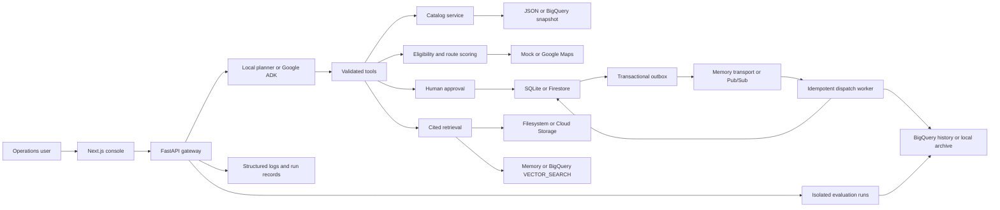

# GeoOps AI

GeoOps AI is a geospatial operations assistant for a fictional field-service company. It combines ticket and technician records, deterministic eligibility rules, route evidence, cited documents, agent tools, human approval, asynchronous dispatch, and reproducible evaluation.

The ten implementation phases are present in this repository. Local mode runs without Google Cloud or model credentials. Cloud adapters, Terraform, and release pipelines are included. Cloud provisioning and managed-provider verification require your project and credentials; no cloud resources were created during implementation.

## Run locally

Use Node 24 LTS, pnpm 10.29.3, Python 3.13, and uv. Docker is optional. Next.js 16.4.6 and React 19.3.1 are pinned with the package lockfile.

```bash
cp .env.example .env
make setup
make seed
make dev
```

Open the [console](http://localhost:3000), [API health](http://localhost:8000/health), or [OpenAPI documentation](http://localhost:8000/docs). Stop both development processes with Ctrl+C.

If `make` is unavailable, run the underlying commands:

```bash
pnpm install --frozen-lockfile
uv sync --frozen --all-packages
uv run --package geoops-api python -m geoops_api.seed
pnpm dev
```

The example configuration uses a persistent SQLite database in ignored `data/runtime/`. Tests use isolated memory databases. Operational records are synthetic and anchored to the seed's reference clock. The overview derives its counts from the API and displays that clock beside SLA results.

## Use the workflow

1. Search tickets and inspect technician qualifications in the console.
2. Ask the agent, `Who is the best technician for ticket 184?` to see the deterministic ranking and route estimate.
3. Ask, `What procedure should I use to troubleshoot ticket 184?` to retrieve cited manual and service-history passages.
4. Ask, `Assign James Chen to ticket 184` to create a validated approval proposal.
5. Open **Approvals**, enter a reviewer label, and approve or reject the proposal.
6. The dispatch worker rechecks the current assignment and eligibility, then records `executed` or `failed`. The queue refreshes automatically.
7. Open **Evaluations** to run the labeled suite and compare recorded results.

Assignments require a persisted approval. Approval and its outgoing event commit together. Delivery retries use stable IDs, and the worker commits the assignment, terminal status, and event history atomically. Repeated delivery does not duplicate an assignment.

## Architecture



Local development calls the API directly. A server-side web proxy is available for deployed environments. It adds service credentials outside the browser and uses Cloud Run identity tokens for the private API. The private worker accepts Pub/Sub push requests, while Cloud Scheduler invokes its relay endpoint.

Application services stay in the API package so the local process and worker share the same policy code. Container targets provide separate API, web, worker, and ingestion runtimes without duplicating business logic.

## Repository layout

```text
apps/api/src/geoops_api/
  agent/                 Typed tools, local planner, and ADK adapter
  approvals/             Proposal validation and decision rules
  knowledge/             Document parsing, chunking, and retrieval
  maps/                  Mock and Google routing adapters
  repositories/          JSON and BigQuery catalog readers
  routers/               Typed HTTP boundaries
  state.py               SQLite and Firestore transactions
  workflow.py            Atomic approval, outbox, and assignment operations
  worker.py              Delivery relay and dispatch consumer
  worker_app.py          Private push receiver
  evaluation.py          Labeled suite, metrics, gates, and CLI
  telemetry.py           Agent runs, session context, and analytical export
apps/web/                 Operations, agent, approval, and evaluation interfaces
data/seed/                Reproducible operational snapshot
data/documents/           Versioned source documents
data/evaluation/          Scenarios and regression thresholds
data/schema/              BigQuery DDL
infrastructure/terraform/ Cloud resources, provider lock, and offline plan tests
scripts/                  Schema generator and live acceptance check
.github/workflows/ci.yml  Repository verification and container builds
cloudbuild.yaml           Evaluation-gated image release and deployment
```

## Configuration

`.env.example` is the canonical configuration contract. FastAPI validates settings on startup. Values with `NEXT_PUBLIC_` enter browser bundles and must contain no secrets.

| Variables                                                              | Local default                                                   | Purpose                                                              |
| ---------------------------------------------------------------------- | --------------------------------------------------------------- | -------------------------------------------------------------------- |
| `APP_ENV`, `LOG_LEVEL`, `HOST`, `PORT`                                 | `development`, `INFO`, `0.0.0.0`, `8000`                        | API runtime                                                          |
| `CORS_ORIGINS`                                                         | Local web origins                                               | Allowed direct browser callers                                       |
| `SEED_DATA_PATH`                                                       | `data/seed/geoops_seed.json`                                    | Synthetic catalog                                                    |
| `MAPS_PROVIDER`, `GOOGLE_MAPS_API_KEY`                                 | `mock`, unset                                                   | Opt-in Google routing                                                |
| `MAPS_TIMEOUT_SECONDS`                                                 | `10`                                                            | Outbound map timeout                                                 |
| `MODEL_PROVIDER`, `MODEL_NAME`                                         | `local`, `geoops-local-planner-v1`                              | Local, `gemini_api`, or `vertex_ai` runtime                          |
| `GEMINI_API_KEY`                                                       | unset                                                           | Developer API credential                                             |
| `GOOGLE_CLOUD_PROJECT`, `GOOGLE_CLOUD_LOCATION`                        | unset, `us-central1`                                            | Cloud identity and location                                          |
| `APPROVAL_STORE`, `STATE_DATABASE_PATH`                                | `sqlite`, `data/runtime/state.sqlite3` in the example           | Operational persistence; `memory` and `firestore` are also supported |
| `APPROVAL_TTL_MINUTES`, `FIRESTORE_APPROVALS_COLLECTION`               | `30`, `approval_requests`                                       | Proposal expiry and Firestore namespace                              |
| `EVENT_BUS`, `PUBSUB_TOPIC`                                            | `memory`, `dispatch-approved`                                   | Event transport                                                      |
| `WORKER_ENABLED`, `WORKER_POLL_SECONDS`                                | `true`, `1` in the example                                      | Local background relay                                               |
| `CATALOG_PROVIDER`, `BIGQUERY_DATASET`                                 | `json`, `geoops`                                                | Analytical catalog reader                                            |
| `ANALYTICS_PROVIDER`                                                   | `local`                                                         | Historical export; optional `bigquery`                               |
| `DOCUMENT_PROVIDER`, `KNOWLEDGE_DOCUMENTS_PATH`, `DOCUMENTS_BUCKET`    | `local`, `data/documents`, unset                                | Filesystem or `gcs` originals                                        |
| `VECTOR_PROVIDER`                                                      | `memory`                                                        | Optional `bigquery` vector repository                                |
| `EMBEDDING_PROVIDER`, `EMBEDDING_MODEL`, `EMBEDDING_DIMENSIONS`        | `local`, `gemini-embedding-001`, `256`                          | Deterministic or Google embeddings                                   |
| `KNOWLEDGE_CHUNK_SIZE`, `KNOWLEDGE_CHUNK_OVERLAP`                      | `900`, `120`                                                    | Heading-aware source chunks                                          |
| `AGENT_TIMEOUT_SECONDS`                                                | `60`                                                            | Request deadline; ADK also limits model-call rounds                  |
| `EVALUATION_DATASET_PATH`, `EVALUATION_THRESHOLDS_PATH`                | `data/evaluation/cases.json`, `data/evaluation/thresholds.json` | Labeled regression configuration                                     |
| `MODEL_INPUT_USD_PER_MILLION`, `MODEL_OUTPUT_USD_PER_MILLION`          | unset                                                           | Optional user-supplied prices for cost estimates                     |
| `API_TOKEN`                                                            | unset locally, required in staging and production               | Service authentication                                               |
| `NEXT_PUBLIC_API_BASE_URL`                                             | `http://localhost:8000`                                         | Browser API origin; build with an empty value to use the web proxy   |
| `API_INTERNAL_BASE_URL`, `GEOOPS_API_TOKEN`, `API_USE_GOOGLE_ID_TOKEN` | Local API URL, unset, `false`                                   | Server-only proxy configuration                                      |

Use Application Default Credentials for Vertex AI, Firestore, BigQuery, Cloud Storage, and Pub/Sub. Ingestion and search must use the same embedding model and dimensions. Maps estimates stay labeled throughout recommendations and approvals.

## Verify changes

```bash
make lint
make typecheck
make test
make eval
make build
make verify
```

`make verify` starts disposable web and API processes, calls through the real web proxy, creates and approves a proposal, waits for worker completion, runs evaluation, and checks the rendered workspace routes. It removes its temporary state and stops both processes afterward. It needs permission to bind local ports.

The evaluation suite measures tool selection, labeled arguments, expected answer facts, retrieval recall, citation metadata integrity, approval correctness, policy compliance, and observed latency. Unknown token usage and cost stay null. See [evaluation metrics](docs/evaluation.md) for definitions and limits.

Validate infrastructure without provisioning resources:

```bash
terraform -chdir=infrastructure/terraform init -backend=false
terraform -chdir=infrastructure/terraform fmt -check
terraform -chdir=infrastructure/terraform validate
terraform -chdir=infrastructure/terraform test
```

`terraform test` uses a mocked provider. Regenerate table schemas with `uv run python scripts/generate_tables.py`. The generated Terraform schemas come from the committed SQL DDL.

## Containers and deployment

```bash
make docker
docker build -f apps/api/Dockerfile --target production -t geoops-api:local .
docker build -f apps/api/Dockerfile --target worker -t geoops-worker:local .
docker build -f apps/api/Dockerfile --target ingestion -t geoops-ingestion:local .
docker build -f apps/web/Dockerfile --target production -t geoops-web:local .
```

API and web runtime images use non-root users and health checks. The worker shares the API runtime image. The ingestion target is a finite job. Compose provides hot reload and a persistent local state volume on ports 3000 and 8000.

Follow [the deployment guide](docs/deployment.md) to bootstrap images and secrets, review a Terraform plan, load the synthetic catalog, and deploy. `cloudbuild.yaml` defaults to image builds without deployment. Set `_DEPLOY=true` after provisioning the services. The pipeline blocks release when tests or evaluation gates fail.

## API reference

| Endpoint                                                                                   | Purpose                                                                                 |
| ------------------------------------------------------------------------------------------ | --------------------------------------------------------------------------------------- |
| `GET /health`                                                                              | Deterministic process-health contract                                                   |
| `GET /api/operations`, `GET /api/assignments`                                              | API-derived overview and active assignments                                             |
| `GET /api/tickets`, `GET /api/tickets/{id}`                                                | Ticket search and operational detail                                                    |
| `GET /api/technicians`, `GET /api/technicians/{id}`                                        | Technician availability, qualifications, and schedule                                   |
| `GET /api/dispatch/recommendations/{ticket_id}`                                            | Eligibility gates, rankings, route evidence, and exclusions                             |
| `POST /api/maps/geocode`, `/api/maps/routes`, `/api/maps/route-matrix`                     | Configured maps provider                                                                |
| `GET /api/knowledge/documents`, `POST /api/knowledge/search`, `POST /api/knowledge/ingest` | Cited retrieval and ingestion                                                           |
| `POST /api/chat`                                                                           | Agent answer, tools, sources, recommendation, approval requirement, and correlation IDs |
| `GET /api/approvals`, `POST /api/approvals`, `GET /api/approvals/{id}`                     | Proposal creation and status                                                            |
| `POST /api/approvals/{id}/approve`, `/api/approvals/{id}/reject`                           | Explicit human decisions                                                                |
| `GET /api/evaluations`, `POST /api/evaluations/run`, `GET /api/evaluations/{id}`           | Recorded agent evaluations                                                              |

`GET /health` returns `{"status":"ok","service":"geoops-api","environment":"development","version":"0.1.0"}` locally. Every API response carries `X-Request-ID`. Logs record correlation IDs, tool and agent latency, model usage when available, and dispatch outcomes. Logs omit request bodies and credentials.

## Phase status

1. Foundation: workspace, web shell, FastAPI, validated configuration, tests, and containers.
2. Domain and data: typed records, deterministic seed, repository boundaries, catalogs, and BigQuery schemas.
3. Dispatch: eligibility rules, inspectable ranking, and operator workbench.
4. Maps: local and Google adapters, geocoding, routes, and route matrices.
5. Knowledge: documents, chunking, embeddings, metadata filters, citations, and vector retrieval.
6. Agent: local and ADK runtimes, typed tools, session context, evidence, and workspace.
7. Human approval: validated proposals, expiry, atomic decisions, and review queue.
8. Async dispatch: transactional outbox, event transport, idempotent worker, retry handling, and operational updates.
9. Evaluation: labeled scenarios, measured results, comparison dashboard, persistent history, and regression gates.
10. Delivery and observability: structured telemetry, cloud adapters, Terraform, separate identities, Secret Manager, GitHub CI, and Cloud Build.

Implementation and local verification are recorded in [the verification report](docs/verification.md). Docker builds, managed-provider calls, and deployed GCP connectivity remain environment-dependent checks. The simulation uses a bounded catalog snapshot and shared service authentication; benchmark catalog scale and integrate verified application user identities before using it with live field-service data.

More detail: [data model](docs/data-model.md), [dispatch policy](docs/dispatch-policy.md), [maps providers](docs/maps-providers.md), [knowledge retrieval](docs/knowledge-retrieval.md), [agent orchestration](docs/agent-orchestration.md), [human approval](docs/human-approval.md), and [async dispatch](docs/async-dispatch.md).
